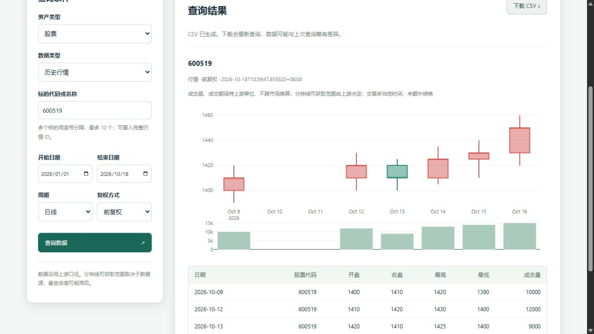

# 0.6.0 实施与验证记录

日期：2026-10-18，验证更新：2026-10-19。状态：代码及文档已交付；本机三个 Python 版本及移动视口验证通过，Docker、远程 CI、手机实机与上游稳定性验收未完成。没有发布安装包、推送代码或部署线上服务。

## 阶段交付

| 阶段 | 实施结果 | 验证 |
| --- | --- | --- |
| 既有修复整理 | 缓存过期天数修复；测试数量说明同步；0.5.9 修复保留在日志，最终开发版本 0.6.0 | 原有离线 10 项全通过 |
| 请求与异常 | 共享 Session、原子配置、全局请求闸门、单层重试、异常分类；原直接 requests 调用迁入共享入口 | 配置快照、并发/间隔、Retry-After、耗尽原因链和不重试格式错误通过 |
| 批量与数据规范 | 有界批量、部分结果、失败重试、取消、进度、旧入口异常回传；非破坏性校验 | 顺序、去重、部分失败、取消、OHLC、空表、必需结构检查通过 |
| 测试 CI | 核心 3.6/3.9/3.12、pandas 3/网页、双浏览器、Docker 工作流；联网独立手动触发 | 3.12 的 94 项通过；3.6/3.9 各 87 项通过、7 项网页测试按版本边界跳过；远程 CI 尚未运行 |
| CLI 与导出 | quote/history/doctor/web，CSV/JSON/Excel/Parquet，覆盖保护、失败清单 | CLI 退出码、部分导出、BOM、Excel 文本代码、Parquet 往返通过 |
| 网页与部署模板 | 四类资产查询、图表表格、重新查询导出、认证、源码构建 Docker、反代文档 | HTTP 测试及桌面/320/390 像素视口交互通过；Docker 未执行 |

## 已执行的检查

- Python 3.12.7、pandas 3.0.3：`python -m unittest discover -s tests -p "test_*.py" -q`，94 项通过，无跳过（核心与网页 35 项、审查回归 54 项、验收工具 3 项、索引专项 2 项）。
- Windows 便携 Python 3.6.8、pandas 1.1.5、urllib3 1.26.20：同一套 94 项中 87 项通过，7 项网页测试按 Python 3.12+ 的服务边界跳过；原有 10 项离线检查通过。依赖按 `tests/constraints-py36.txt` 约束；旧 TLS 无法直接下载的依赖由 3.12 下载后离线安装，未关闭 TLS 校验。另安装 openpyxl 3.0.10、pyarrow 6.0.1，实际验证可选导出。
- Windows 便携 Python 3.9.13、pandas 2.3.3：同一套 94 项中 87 项通过，7 项网页测试按版本边界跳过；原有 10 项离线检查通过。另安装 openpyxl 3.1.5、pyarrow 21.0.0 验证导出。便携运行时及浏览器引擎仅存放在被 Git/Docker 忽略的 `.validation-runtimes`，未改系统 Python。
- 三个版本的运行时、依赖版本、通过/跳过数量及原始输出保存在 `compatibility-validation-results.json`。重新构建的 wheel 已在三个独立核心环境安装，并离开源码目录验证从 site-packages 导入、离线 doctor 和未安装/导入 FastAPI。
- `python tests/offline_regression.py`：原有 10 项通过，无失败、无跳过。禁止外部 socket，未请求上游。
- 核心库及 CLI 通过 Python 3.6 语法解析；`compileall` 和 `git diff --check` 通过。
- sdist 与 wheel 成功构建，包含网页静态资源及可选依赖元数据。
- 在独立 venv 从 wheel 安装成功，离开项目目录导入到 site-packages；确认未安装或导入 FastAPI，`efinance doctor` 成功。干净依赖环境包含 pandas 3.0.6。
- 桌面浏览器用测试进程内的固定样本验证 K 线、成交量、净值曲线、代码前导零、空结果、限流提示和 CSV 下载。固定样本仅在临时测试服务中注入，产品运行入口没有模拟数据回退。
- 新增 `tests/web_browser.cjs`，用真实本地页面和 Plotly 资源、浏览器拦截的固定 API 样本验证 320×844、390×844、1280×844 三种视口。图表、表格、下载 BOM、空结果、超时、限流、单任务和无页面横向溢出均通过；外部资源请求被禁止。结果在 `browser-validation-results.json`，截图在 `images/query-mobile-320.png`、`images/query-mobile-390.png`、`images/query-desktop-1280.png`；浏览器检查已加入 CI。

## 审查问题修复

新增 `tests/test_review_regressions.py` 并纳入核心 CI 的自动发现，覆盖以下已确认问题：

- **文件名碰撞**：模拟 Windows 大小写规则，验证 AAPL/aapl 在有、无覆盖选项时都在请求前拒绝，既有文件保持完整；另验证结果不得占用失败清单文件名。
- **CSV 编码**：使用 GBK TextIOWrapper 和设置 `PYTHONIOENCODING=gbk` 的真实子进程验证，输出可按 UTF-8 BOM 正确解码，包含中文和前导零。
- **重试状态**：失败后取消重试，再清除事件成功重试，结果状态互斥；未启动的原始取消项保持取消，原成功项不重复执行。
- **期货查询**：验证普通代码解析后才发送 secid、完整 ID 不触发索引重建、未知代码在行情请求前报错，以及 CLI 实际调用链。
- **响应体超时**：本机 HTTP 服务先返回响应头再延迟响应体，确认真实 Requests 包装异常被分类为 TimeoutError；同时验证重试次数、HTTP 504 映射、异常链循环防护和连接拒绝不被误判。
- **分页重试预算**：验证显式预算 1 和 2 在实时行情分页中生效，业绩和股东人数分页同样继承预算；复用工作线程后上下文恢复，嵌套 batch.fetch 继承父任务的设置。
- **JSON 编码**：在 GBK TextIOWrapper 和真实 GBK 子进程中验证中文、emoji 与代码前导零；多标的输出仍为可逐行解析的 UTF-8 NDJSON，不添加 BOM。
- **基金净值质量**：通过真实 getter 的固定 JSON 样本验证单位净值为空、非法文本及非有限数值时严格模式报错；累计净值占位值和涨跌幅缺省仍可返回。warn/off 不修改数据，正常空表与必需字段缺失分开处理。
- **参数与解析错误边界**：SDK 缺少参数、未知参数、None 和错误日期在请求前报 ParameterError；本地普通 TypeError/ValueError 保持原类型，错误 K 线数据结构仍带原因链转换为 ResponseError。
- **分页测试稳定性**：原测试在首个分页失败后，可能因另一个任务被取消而随机失败；增加同步屏障，确保两个分页均启动后再模拟失败。修复后连续执行 30 次通过。
- **基本信息缓存命中**：移除 dict.get 默认值的提前网络求值；验证命中时基本信息服务不可用仍可查询成交明细，未命中只加载一次，代码前导零保留。JSON 文件缓存机制未变。
- **重定向逐跳限流**：将闸门移至单次 send，跳转前释放并发名额。通过本机三跳 HTTP 链验证逐跳间隔、单并发无死锁、请求中途修改配置不影响已有快照、Cookie 传递、history 和禁止跳转行为。
- **非 JSON 响应结构**：基金代码列表验证 rankData/datas，快照验证 JSON/JSONP 及行情结构。错误页、缺字段和损坏记录抛 ResponseError；合法空结果保留原结构。正常快照测试同时发现并修复 pandas 3 将全字符串 Series 推断为字符串类型后不能写入浮点数的问题。
- **OHLC 非有限值**：四个价格字段的正负无穷及字符串 Infinity 在严格模式报错，默认告警，off 不校验；各模式均不修改原表，合法负复权价格仍接受。
- **响应体截断**：本机 HTTP 服务分别模拟 Content-Length 不足和分块传输中断，验证每次尝试均经过请求闸门、耗尽后抛 NetworkError 并保留 ChunkedEncodingError 原因链和次数，以及第二次请求成功恢复。网页实际调用此请求链后返回结构化 502。
- **旧 urllib3 响应长度**：3.6 实测发现 urllib3 1.x 默认允许 Content-Length 不足而不报错。新增响应钩子，在用户钩子及正文读取前启用长度校验；已有截断回归在三个 Python 版本通过，也覆盖用户钩子主动读取正文后的重试恢复。
- **基金 JSON 结构**：历史净值与实时估值均要求顶层对象包含 Datas 记录列表。null、对象/字符串容器、非对象记录及缺字段记录按 ResponseError 处理；validation=off 也不跳过结构校验。合法空列表保留原有列，正常估值保留代码前导零及数值转换。
- **批量导出部分失败**：通过真实不可写路径验证首个文件失败不阻断后续文件，导出失败与查询失败一并按输入顺序记录；另覆盖序列化错误、失败清单自身不可写时 stderr 保留详情，以及部分参数错误的退出码。
- **行情 JSON 与合法空资金流**：历史 K 线、最新行情、最近分钟线和历史/日内资金流直接校验声明的记录列表及元素类型，拒绝缺失容器、对象/字符串容器及错误元素，不递归搜索其他位置的同名字段。合法 data=null 或空列表保持既定列；修复日内资金流在判断空结果前读取名称而抛错的问题。固定样本同时验证正常资金流和分钟线的名称、行数及代码前导零。
- **Docker 非 root 缓存权限**：原模板只授权源码目录，控制台入口加载安装包时可能无法创建或写入 site-packages 内的原缓存目录。模板现在单独创建并授权该目录，保持路径与缓存机制不变；Docker CI 增加隔离导入后的临时文件写入检查。本机仍无 Docker，容器实测未执行。
- **完整验收工具**：新增逐项 JSON 报告和可配置的全局请求默认超时/次数；修复空前置结果仍被用于选取样本的问题。原搜索降级检查使用了过时的默认返回空串假设，现通过固定无匹配结果验证显式 suppress_error=True 的约定，并在报告中标明其为离线检查；默认仍抛 SymbolNotFoundError。报告文件、跳过和失败退出码均有单元测试。
- **PDF 实测发现并修复的缺陷**：max_count=1 原来截取列表尾部，实际下载到 2012 年报告，与最新优先的说明相反。改为列表头部并限制 pageSize；下载前检查 PDF 文件头，空响应/HTML/JSON 错误页按失败回传，不覆盖已有文件；0 个不请求，非法数量在请求前拒绝，进度条在失败时也能关闭。回归覆盖最新选择、结构错误、参数和原文件保护。

审查回归禁止外部网络，仅允许测试 HTTP 服务和 Windows asyncio 所需的本机连接。这些检查不依赖上游接口在线状态，也不改变原有 JSON 缓存机制。

## 联网验证

受限冒烟检查使用连接 5 秒、读取 10 秒、总尝试 1 次，避免批量验证放大请求：

- 股票 `1.600519` 历史行情：2026-10-01 至 2026-10-16，返回 7 行，列结构正常。
- 基金 `000001` 历史净值：同一区间，返回 7 行，列结构正常。
- 之后浏览器的股票查询遇到环境代理连接失败，网页展示了错误，说明数据源可用性并不稳定。

2026-10-18 的通过结果保存在 `online-smoke-results.json`。当时没有全量执行 38 个联网公开函数，也未验证可转债和期货的实时上游状态；四类资产的查询路由均有离线打桩测试。不得将两项冒烟通过解释为所有接口在线可用。

2026-10-19 补充运行 `tests/online_acceptance.py`：默认连接 5 秒、读取 10 秒、总尝试 1 次、每秒 2 次，不下载报告文件。首轮 7 项通过、1 项失败、2 项跳过，取得股票及基金的最新/历史数据、可转债市场列表及其最新/历史数据；期货市场列表返回 503。随后指定已有期货连续合约 ID `113.rbm` 再检查，4 项通过、4 项失败、2 项跳过：股票/基金历史、基金估值和期货历史通过；股票及期货最新行情连接失败，转债和期货市场列表返回 503，转债两项依赖检查跳过。最新逐项记录、行数、错误和耗时保存在 `online-acceptance-results.json`。两次结果说明上游并不稳定，不能据此宣称联网接口全部验收通过。

随后执行完整的 `tests/regression.py` 入口（声明覆盖 38 个公开函数，依赖失败的函数仍可能未执行）。首轮报告为 33 项通过、7 项失败、4 组跳过，保存在 `full-online-regression-initial-results.json`；其中一个失败来自上述过时的搜索降级用例。修正后再运行，`full-online-regression-results.json` 记录 **47 项通过、8 项失败、2 组跳过**。检查数量包含缓存/解析与离线检查，不能当作公开函数数量。

- 本轮通过：股票历史行情、基本信息、板块、资金流、成分股、快照、股东/IPO/业绩等；转债列表、历史和基本信息；基金列表、净值、估值、持仓、行业/类型分布、区间涨幅、公开日期及经理信息等。
- 6 项网络失败：股票最新行情及成交明细、转债成交明细、期货列表、股票全市场列表、期货基本信息，原始网络异常与 503 保留在报告。
- 2 项空结果未验收：样本转债 `123286` 的日内/历史资金流返回 0 行，未计为通过，也不据此认定为代码错误。
- 2 组跳过：旧缓存未提供同代码多候选；期货列表不可用，未取得当期样本验证两个依赖接口。此轮基金列表恢复可用，因此基金依赖检查实际执行。

### 后续真实数据与跨浏览器补验

- `end-to-end-acceptance-results.json`：**7 项通过，0 项失败**。使用真实上游的同一封闭历史区间，将 CLI 的 CSV/JSON/Excel/Parquet 文件逐项与 Python 查询结果比较，检查覆盖保护；验证真实网页 API 的认证、历史记录及 CSV 下载。首轮 CSV 检查受测试脚本自动换行转换影响，已改为比较原始字节；首轮报告仍保留在 `end-to-end-acceptance-initial-results.json`，不是产品 CSV 编码问题。
- `live-browser-acceptance-results.json`：股票、基金、转债、期货 **4 类全部通过**，均为真实页面、真实 API 和真实上游，无数据打桩。每类完成移动视口下的查询、图表、表格和 CSV 下载；截图 `images/query-live-*-mobile.png`。各类固定闭合区间本轮均为 7 行。
- `browser-validation-results.json` 和 `webkit-validation/browser-validation-results.json`：Chromium/Edge 与 Windows WebKit 分别通过 320、390、1280 像素三种视口的固定样本检查，覆盖空结果、超时、限流和单任务控制等。WebKit 也已纳入浏览器 CI；Windows WebKit 不等于 iOS 手机实机验证。
- `pdf-download-acceptance-results.json`：补验原先因下载副作用而未纳入全量入口的 PDF 函数。最多下载 1 份到自动清理的临时目录，修复后实得《华夏成长证券投资基金2026年中期报告》，发布日期 2026-08-31，1,554,258 字节，匹配列表首项且具备 PDF 文件头；测试文件已清理。最初下载到 2012 年报告的记录保留在 `pdf-download-acceptance-initial-results.json`。
- `upstream-followup-results.json`：显式使用此前成功的 `0.128142` 补测，转债历史及日内/历史资金流均有数据，原新上市样本的空结果未被改写为通过；显式 `113.rbm` 的期货历史也通过。股票最新行情本轮恢复可用，但成交明细和市场列表仍有网络失败。
- `network-diagnostic-results.json`：只作诊断，对同一现有源分别测试 HTTP/HTTPS、系统代理默认路由/临时直连，期货列表和成交明细仍遇到连接断开或 503。没有修改产品端点、代理默认行为或引入其他数据源，诊断后恢复设置；不能将这些接口标为已通过。

以上各轮包含重复、依赖检查和诊断项，数量不能直接相加作为接口覆盖数。当前仍未达到“全部环境与所有实时接口均验收通过”。按用户要求，先继续验证，**不提交、不推送，也不要求先提交来触发 CI**。

随后按用户限定范围复验连通性与索引：`connectivity-acceptance-results.json` 两轮 7 项通过、1 项网络失败，各类成交明细都取得真实 30 行；七组完整重建两次仍全部 503，使用临时缓存且原文件前后校验一致。定向检验发现并修复冷缓存名称表未初始化完成就被并发读取的问题，完整离线多候选/重读检查通过，并发用例连续 20 次通过。**真实完整重建仍未通过**。详见 `quotes-index-validation.md`。

## 待外部环境验证

- Python 3.6/3.9 的 Windows 实际运行已补齐；Linux 容器平台仍需远程 CI 验证。
- 本机没有 Docker 可执行程序，也没有可用的 WSL 发行版；镜像构建与容器健康检查需在 Docker 环境或 CI 执行。
- 移动视口浏览器验证已完成；Android/iOS 手机实机未测试。
- GitHub Actions 尚未远程执行，当前不提交或推送代码。Linux/Docker 验收仍需要可用的本地或测试环境，不能用已编写工作流代替实测。线上 TLS、反向代理与认证需要部署环境验收。

## 使用与维护入口

- `upgrade-execution-plan.md`：约束、默认值与阶段验收。
- `upgrade-guide.md`：API、CLI、导出、数据口径及测试命令。
- `web-deployment.md`：本机启动、认证、容器、单进程限制及 HTTPS 模板。

JSON 缓存路径、格式、TTL 和加载机制未变，没有引入任何数据库或查询结果持久化服务。
